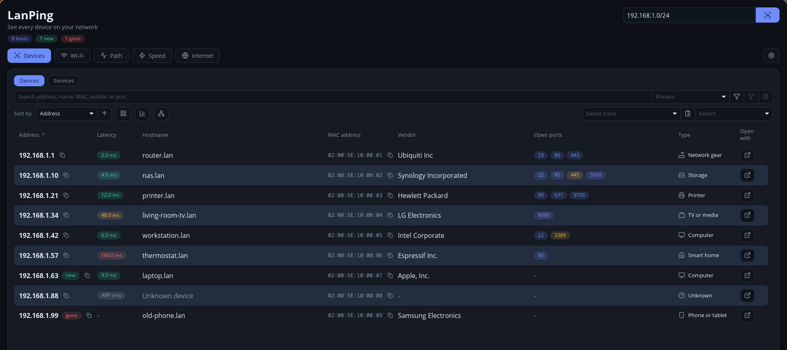

<div align="center">


# LanPing

**See every device on your network.**

A LAN scanner for the desktop, written in Rust with an [Iced](https://iced.rs) GUI. No root or admin rights needed.

[](https://github.com/Gren-95/lanping/actions/workflows/ci.yml)
[](https://github.com/Gren-95/lanping/releases/latest)
[](#license)
[](https://www.rust-lang.org)

[**Download**](https://github.com/Gren-95/lanping/releases/latest)



<sub>The screenshot uses the made-up scans in <code>docs/demo</code>.</sub>

</div>

## Download

Get the latest build from [Releases](https://github.com/Gren-95/lanping/releases/latest):

- **Linux:** `LanPing-<version>-x86_64.AppImage`. Make it executable with `chmod +x`, then run it.
- **Windows:** `LanPing-<version>-x86_64.exe`. It is unsigned, so SmartScreen warns on first launch.

macOS has no prebuilt download and is untested.

## Features

**Scanning**

- Scan a CIDR block, an address range or a single IP (`192.168.0.0/24`, `10.0.0.1-50`)
- Runs without root or admin rights: ICMP datagram sockets, TCP connect probes and the OS ARP cache
- Hostname, MAC address and vendor (IEEE OUI registry embedded), plus IPv6 addresses from the neighbor cache
- Names, models and services that devices announce over mDNS, NetBIOS and SSDP/UPnP
- Optional read-only SNMP v2c for model, serial number, uptime and port count
- TCP port scan of live hosts for the ports ticked in Settings; untick them all to skip it
- Optional service banners, such as the SSH version or web server
- Suggestions for your networks and Tailscale devices as you type; virtual adapters (Docker, VMs, VPNs) are hidden by default
- Optional scans at startup, on a timer or when the main network changes, with desktop notifications for new devices, newly opened ports and named devices going offline

**Results**

- Sortable table or card view, with search, filters and saved presets
- A best guess at each device's type, with an icon and a filter, and at its operating system
- Reorder and hide columns by dragging, from Settings or by right-clicking a column header
- Click a device for its ports, banners, scan history and a timeline of what changed
- Devices are tagged new, changed or gone against the previous scan of the same network
- Open ports worth a second look are shown in amber, with a hint (not a security audit)
- Name your devices and note the owner, location and tags; these are stored by MAC address, so they follow a device between scans
- Every finished scan is saved and can be reopened from "Saved scans"
- A summary of totals by type, vendor and open port, and a map of devices grouped around the gateway
- Export to CSV or JSON, or copy the visible rows

**Actions**

- Open in a browser or browse an SMB share
- Ping, traceroute and Wake-on-LAN
- Copy the SSH command, IP, MAC or hostname
- Keyboard shortcuts: Ctrl+F to search, Enter to scan, Esc to clear filters or close a dialog

## Build and run

Needs Rust 1.90 or newer.

```bash
cargo run --release -p lanping                                   # GUI
cargo run --release -p lanping-core --example scan_cli -- 192.168.0.0/24 22,80   # CLI
cargo test --workspace
scripts/build-appimage.sh                                          # needs appimagetool on PATH
```

## Demo data

`docs/demo` holds two made-up scans, so the app can be shown without a real network. To open them without touching your own settings or saved scans:

```bash
demo="$(mktemp -d)"
mkdir -p "$demo/data/lanping/scans"
cp docs/demo/*.json "$demo/data/lanping/scans/"
XDG_CONFIG_HOME="$demo/config" XDG_DATA_HOME="$demo/data" \
  cargo run --release -p lanping -- "$demo/data/lanping/scans/scan-1790003600.json"
```

Any saved scan file can be opened the same way: `lanping path/to/scan.json`.

## Releases

Pushing a version tag (`git tag v0.2.0 && git push origin v0.2.0`) builds the Linux AppImage and the Windows `.exe` in GitHub Actions and attaches them to a GitHub Release.

## Layout

- `crates/lanping-core`: scan engine, no UI dependencies
- `crates/lanping`: Iced application

## Notes

- Scanning is IPv4 only. Found devices also show the IPv6 addresses in the OS neighbor cache (Linux and macOS), matched by MAC address.
- Settings, device names and saved scans live in the platform config and data folders (`lanping`). Data from the earlier `lansweep` folders is moved there on first start.
- Notifications use `notify-send` (Linux) and `osascript` (macOS); Windows shows results in the app only.
- Hosts that ignore ping and TCP are found through the ARP cache and show no latency. Entries
  the OS cached shortly before the scan can appear as hosts that have just left the network.
- `crates/lanping-core/data/oui.tsv` is generated from the IEEE MA-L registry
  (`https://standards-oui.ieee.org/oui/oui.csv`).
- Common port numbers and names follow Wikipedia's
  [List of TCP and UDP port numbers](https://en.wikipedia.org/wiki/List_of_TCP_and_UDP_port_numbers) (CC BY-SA).
- Icons come from [Lucide](https://lucide.dev) (ISC license) through the `iced_fonts` crate.

## License

Licensed under either of [Apache License 2.0](LICENSE-APACHE) or [MIT license](LICENSE-MIT), at your option.
